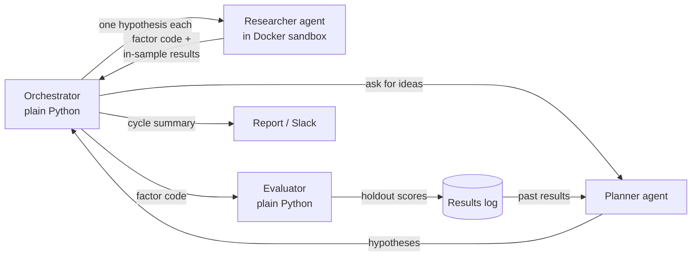

# quant_agent

A self-directed project to learn how AI agents work by building one from
scratch, then growing it into a small automated research loop that proposes,
implements, and scores equity factors, and reports back on a schedule.

The aim is understanding, not alpha. The research task is a realistic test bed:
it needs real tools (code, data, a backtester), it has real failure modes
(bugs, overfitting, false discoveries), and success can be measured.

## How it works



| Component | What it is | LLM? |
|---|---|---|
| **Agent loop** | One loop that calls the model, runs the tools it asks for, and feeds results back until the task is done. Every agent role reuses it with a different prompt, tool set, and permissions. | yes |
| **Planner** | Reads the results log and proposes the next hypotheses to test. Read-only tools. | yes |
| **Researcher** | Turns one hypothesis into factor code and backtests it on in-sample data. File and shell tools, inside a container. | yes |
| **Backtester** | Computes factor returns and statistics. Shared by researcher and evaluator so both score a factor identically. | no |
| **Evaluator** | Scores finished factors on the holdout period with multiple-testing controls and decides pass/fail. | no |
| **Orchestrator** | Runs a cycle (planner → researchers → evaluator), writes logs, and sends the report. | no |

### Ground rules

1. **The researcher never sees holdout data.** This is enforced by what the
   container mounts, not by instructions in a prompt.
2. **Verdicts come from code.** The evaluator decides pass/fail
   deterministically. An LLM may add commentary but never the verdict.
3. **Read-only first.** Agents observe and report before they are allowed to
   act. Nothing places trades.
4. **Log every run.** Inputs, tool calls, outputs, and costs are saved, so a
   bad result can be traced to bad data or bad reasoning.
5. **Model-agnostic interfaces.** The orchestrator talks to "a researcher" through
   one interface (hypothesis in, code + results out), so the homemade agent,
   Claude Code, or Codex can be swapped in behind it.

## Project layout

```
quant_agent/
├── README.md
├── pyproject.toml          # dependencies; uv.lock pins exact versions
├── .env.example            # API key names (copy to .env, never commit .env)
├── agent/                  # the agent loop and its tools
├── prompts/                # system prompts for each agent role
├── evaluator/              # backtester and holdout scoring
├── orchestrator/           # cycle runner and reporting
├── docker/                 # sandbox image for the researcher
├── scripts/
│   ├── fetch_data.py       # downloads prices and builds the in-sample / holdout split
│   ├── run_cycle.sh        # entry point the scheduler calls
│   └── schedule/           # Windows Task Scheduler / macOS launchd files
├── data/                   # gitignored; rebuilt by fetch_data.py
└── runs/                   # gitignored; logs and results of each cycle
```

## Build plan

Each phase adds one idea and ends with something that runs.

### Phase 0 — Environment ✅
WSL2 Ubuntu, Docker Desktop, `uv`, GitHub repo, project scaffold.

### Phase 1 — The bare agent loop
Write the loop directly on the Messages API with three tools: `read_file`,
`write_file`, `run_python`. Give it a factor described by hand (e.g. 12-1
month momentum) and have it implement and backtest it.
*Learn:* tool calling, message history, tool design, error handling.
*Done when:* the agent produces working factor code and a result without help.

### Phase 2 — Backtester, evaluator, and sandbox
Write the backtester and evaluator as plain Python. Split the data by date
into in-sample and holdout. Run the researcher inside a Docker container that
mounts only its workspace and the in-sample data.
*Learn:* trustworthy evaluation, sandboxing, why the holdout must be enforced.
*Done when:* a factor is scored on holdout data the researcher cannot read.

### Phase 3 — Planner and orchestrator
Add the planner role and the orchestrator script. Results go into a log the
planner reads next cycle, so the system builds on what it has already tried.
*Learn:* multi-role systems, memory and state across runs.
*Done when:* one command runs a full cycle end to end.

### Phase 4 — Autonomy and reporting
Run several researchers in parallel, schedule cycles, and post a fixed-format
summary to Slack through a webhook. Add spend limits and stop conditions.
*Learn:* unattended operation, cost control, report design.
*Done when:* a scheduled cycle runs and reports without me touching it.

### Phase 5 — Evals
Build a small set of test hypotheses with known outcomes (including ones that
should fail) and rerun them after every change to prompts, tools, or models.
*Learn:* measuring agent quality instead of judging demos.
*Done when:* every change is checked against the eval set.

### Phase 6 — Compare with mature agents
Plug Claude Code (headless) and Codex in as researchers behind the same
interface and compare them with the homemade agent on the eval set.
*Learn:* what production agents handle that a first build doesn't.

### Later (optional)
Two-way Slack control with a manager agent; move to the Claude Agent SDK
where it saves work; move to a Mac mini or a small cloud VM.

## Data

Free daily equity prices via `yfinance`, split by date into an in-sample
period (visible to the researcher) and a holdout period (visible only to the
evaluator). Data is never committed; `scripts/fetch_data.py` rebuilds it.

## Setup

```bash
git clone git@github.com:NoahZ969/quant_agent.git
cd quant_agent
uv sync                      # create .venv with pinned dependencies
cp .env.example .env         # then add your API key
```

Keep the project in the Linux filesystem (in WSL: under `~`, not `/mnt/c/`).

**Windows (current machine):** run inside WSL2 Ubuntu with Docker Desktop's
WSL integration turned on. Scheduled runs use Task Scheduler calling
`wsl.exe -d Ubuntu -- <repo>/scripts/run_cycle.sh`.

**macOS (planned):** same steps; scheduling uses a launchd file in
`scripts/schedule/`.

## Costs

API usage is billed per token, separately from chat subscriptions. Phases 1–3
should cost tens of dollars at most; develop on a small model and set a
monthly spend limit in the provider console before running anything unattended.

## Status

- [x] Phase 0 — environment and scaffold
- [ ] Phase 1 — bare agent loop
- [ ] Phase 2 — backtester, evaluator, sandbox
- [ ] Phase 3 — planner and orchestrator
- [ ] Phase 4 — autonomy and reporting
- [ ] Phase 5 — evals
- [ ] Phase 6 — comparison with mature agents
